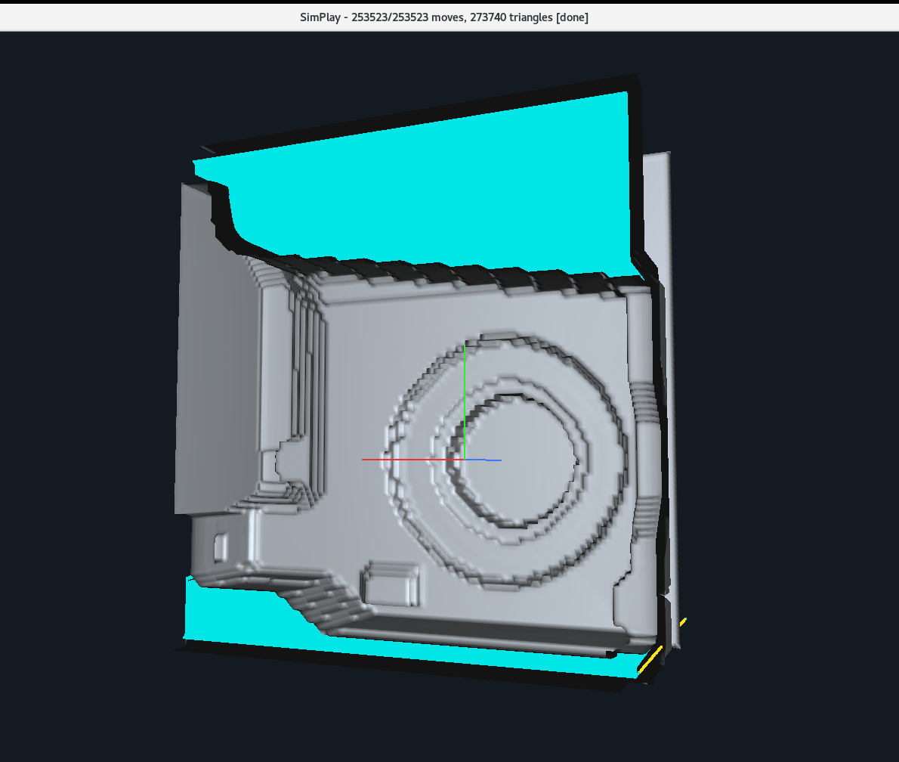
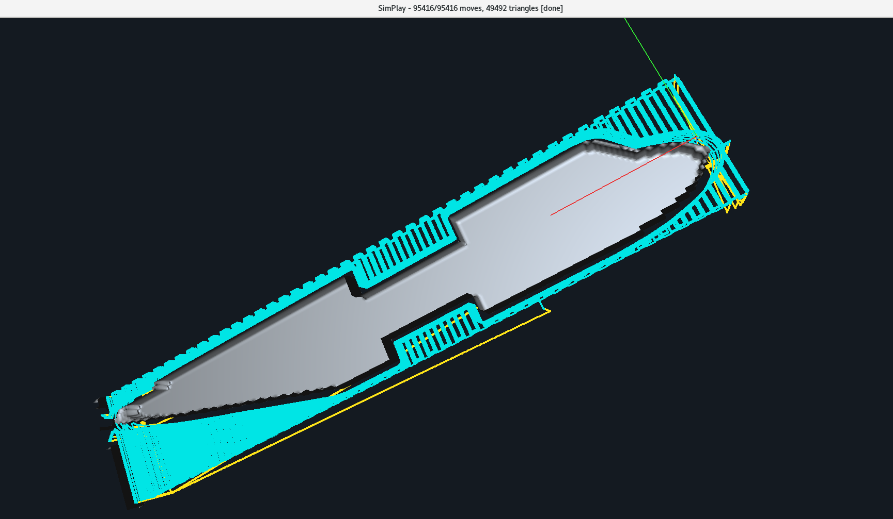

# SimPlay

SimPlay is a C++ project for material removal simulation based on an NC/ISO toolpath, with interactive 3D visualization of the toolpath, cutter, and remaining material after machining.

## What the project does

The application loads an NC/ISO program, parses it into a sequence of linear tool motions, and simulates milling over a voxelized volume. A triangular mesh is then extracted from the resulting scalar field for visualization.

Main capabilities:

- loading NC/ISO files
- interpreting modal G00/G01/G02/G03 motions
- discretizing the toolpath into successive linear segments
- voxel-based material removal simulation
- support for flat-end and ball-end cutters
- mesh reconstruction from volume data using Marching Tetrahedra
- interactive 3D display with rotation, pan, and zoom
- separate visualization of rapid and feed toolpath moves

## Project architecture

The project is organized into several main components.

### Toolpath parsing and loading

- `NCprog` and `NCinstr` read and parse NC instructions
- `ToolPathLoader` converts instructions into a list of `Move` segments
- `ToolPath` stores the motions and computes geometric bounds

### Material simulation

- `Simulator` coordinates initialization, simulation steps, and mesh reconstruction
- `VoxelGrid` stores the scalar field of the remaining material
- `Cutter` defines the cutter geometry and carving operation in the grid

### Geometry generation

- `MarchingTetrahedra` extracts the isosurface from the voxel grid
- `MeshBuilder` provides an alternative mesh construction path
- `TriangleMesh` stores vertices, normals, and indices for rendering

### Visualization

- `Renderer` draws the mesh, cutter, axes, and toolpath
- `SimPlay.cpp` manages the GLUT window, input handling, and application loop

## Execution flow

1. The NC/ISO file is loaded.
2. The program is converted into a `ToolPath`.
3. The working area is determined and the `VoxelGrid` is initialized.
4. At each simulation step, the cutter removes material from the grid.
5. A surface mesh is reconstructed from the grid.
6. The result is displayed in the OpenGL window.

## Typical controls

From the source code, the following controls are available:

- `Space` / `P` - start or pause simulation
- `R` - reset simulation
- `F` - run to the end
- `T` - show/hide toolpath
- `M` - show/hide mesh
- `W` - wireframe on/off
- `+` / `-` - zoom
- left mouse button - pan
- right mouse button - rotate
- middle mouse button / wheel - zoom
- `Q` / `Esc` - quit

## Important files

- `src/SimPlay.cpp` - application entry point
- `src/Simulator.cpp` / `src/Simulator.h` - main simulation logic
- `src/Cutter.cpp` / `src/Cutter.h` - cutter geometric model
- `src/VoxelGrid.cpp` / `src/VoxelGrid.h` - voxelized material representation
- `src/ToolPathLoader.cpp` - conversion from NC to toolpath
- `src/Renderer.cpp` / `src/Renderer.h` - OpenGL rendering layer
- `src/MarchingTetrahedra.cpp` - surface reconstruction
- `src/Config.cpp` / `src/Config.h` - application configuration
- `src/simplay.conf` - runtime parameters

## Configuration

The `simplay.conf` file controls parameters such as:

- `resolution`
- `maxStep`
- `toolDiameter`
- `toolLength`
- `stockMargin`
- `movesPerFrame`
- toolpath colors
- window size

## Dependencies

Based on the analyzed source files, the project uses:

- C++
- OpenGL
- GLUT
- GLU

On Linux, development packages such as `freeglut` and OpenGL libraries are typically required. On macOS, the system OpenGL/GLUT frameworks are used.

## How to run

The application expects an NC file as a command-line argument:

```bash
./SimPlay path/to/program.iso
```

If the file is valid, the simulation is initialized and can be controlled with the keyboard and mouse.

## Current limitations

Based on the code discussed so far, there are several important limitations:

- voxel-grid resolution strongly affects material removal accuracy
- jobs that are very long in X/Y and very thin in Z may require discretization adjustments
- rendering and mesh reconstruction can become expensive for large toolpaths
- the project is desktop-oriented and uses classic GLUT/OpenGL

## Possible future improvements

- separating the simulation engine from the UI layer
- exporting the resulting mesh in standard formats
- porting the project to the browser via WebAssembly + WebGL
- more advanced camera control
- mesh reconstruction optimizations
- more robust support for displaying only the resulting part

## Project purpose

The project is well suited as a base for:

- visual analysis of NC toolpaths
- preliminary validation of tool motion
- experiments with voxel carving and surface reconstruction
- development of an educational or experimental CAM viewer/simulator
